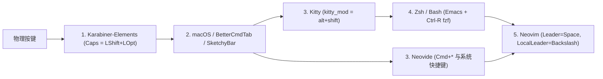

# 全栈键位总览

本文件汇总整套开发环境从硬件重映射到编辑器内部的所有有效按键绑定，并标出跨层拦截与冲突替代方案。

## 按键传递链路

核心约定：

- **Karabiner** 把 `Caps Lock` 映射为 `Left Shift + Left Option`，而 **Kitty** 把 `kitty_mod` 设为 `alt+shift`，因此日常 **`Caps + 键`** 即为 Kitty 快捷键前缀。
- Karabiner 仅拦截 **左** `Shift + Option` 组合的特定按键（`[/m/p/n`），因此使用 **右 `Option + Shift + 键`** 可绕过 Karabiner 触发 Kitty 原生 `kitty_mod` 动作。

---

## 一、全局硬件层（Karabiner-Elements）

配置来源：[karabiner/karabiner.json](karabiner/karabiner.json)

### 1. 基础键与修饰键

| 物理按键 | 映射结果 | 说明 |
| --- | --- | --- |
| `Caps Lock` | `Left Shift + Left Option` | 与 Kitty `kitty_mod`（`alt+shift`）一致 |
| `international3` | `` ` ``（`grave_accent_and_tilde`） | 日式键盘键位兼容 |
| `japanese_eisuu` / `japanese_kana` | `Space` | 日式键盘空白键两边改为空格 |
| `Left Option` | `Left Option` | 显式保留左 Option 透传 |

### 2. 全局 `Ctrl` 映射

| 组合键 | 映射结果 | 备注 |
| --- | --- | --- |
| `Ctrl + [` | `Esc` | 全局拦截，先于终端与 Neovim 生效 |
| `Ctrl + h` | `Backspace` | 全局删前字符 |
| `Ctrl + k` | `Enter` | 全局回车确认 |

### 3. 全局 `Caps + 键`（`Left Shift + Left Option + 键`）

| 组合键 | 动作 | 备注 |
| --- | --- | --- |
| `Caps + [` | 切英文输入法（`Australian`）并在 `~` 呼出 `kitten quick-access-terminal` | 独立浮层终端，配置见 [kitty/quick-access-terminal.conf](kitty/quick-access-terminal.conf) |
| `Caps + m` | 发送 `Cmd + Tab` | 唤起 BetterCmdTab 应用/窗口切换 |
| `Caps + p` | 发送 `Ctrl + ←` | 切换到上一个桌面 Space |
| `Caps + n` | 发送 `Ctrl + →` | 切换到下一个桌面 Space |

> `Caps + 1..9` 切 yabai Space 的规则在 `karabiner.json` 中已禁用（`"enabled": false`），当前直接透传给 Kitty 切换标签。

---

## 二、桌面与应用切换（BetterCmdTab & SketchyBar）

配置来源：[bettercmdtab/config.json](bettercmdtab/config.json)、[sketchybar/sketchybarrc](sketchybar/sketchybarrc)

| 组件 | 触发方式 | 动作 / 槽位 | 说明 |
| --- | --- | --- | --- |
| BetterCmdTab | `Cmd + Tab`（或 `Caps+m`） | `switchApps`（列表视图） | 含最小化窗口；菜单栏图标隐藏；Finder 无窗口时隐藏 |
| BetterCmdTab | 直接激活槽位 1 | `com.google.Chrome` | 槽位顺序配置在 `directActivationBindings` |
| BetterCmdTab | 直接激活槽位 2 | `com.neovide.neovide` | 同上 |
| BetterCmdTab | 直接激活槽位 3 | `net.kovidgoyal.kitty` | 同上 |
| BetterCmdTab | `scopedSwitch.3` | `allAppsCurrentSpace` | 仅切换当前 Space 的窗口（具体按键保存在应用本地外部设置） |
| SketchyBar | 点击顶栏 `一`–`十` | `yabai -m space --focus 1..10` | 鼠标点击切换桌面 Space |

---

## 三、终端层（Kitty）

配置来源：[kitty/kitty.conf](kitty/kitty.conf)，完整默认键与布局细节见 [kitty/README.md](kitty/README.md)。
`kitty_mod = alt+shift`（即 `Caps Lock`）。

### 1. 自定义映射

| 按键 | 日常按法 | 动作 | 说明 |
| --- | --- | --- | --- |
| `ctrl+enter` | `Ctrl+Enter` | `new_tab` | 新建标签 |
| `kitty_mod+h` / `l` | `Caps+h` / `Caps+l` | `previous_tab` / `next_tab` | 上一个 / 下一个标签 |
| `kitty_mod+1..9` | `Caps+1..9` | `goto_tab 1..9` | 跳到第 1–9 个标签 |
| `kitty_mod+r` | `Caps+r` | `set_tab_title` | 重命名当前标签 |
| `kitty_mod+u` / `y` | `Caps+u` / `Caps+y` | 加载 `tabbar-left.conf` / `tabbar-bottom.conf` | 标签栏位置在左侧与底部间切换 |
| `kitty_mod+b` | `Caps+b` | `next_layout` | 下一个分屏布局 |
| `kitty_mod+j` | `Caps+j` | `kitten hints --type word --program -` | hints 选词并直接输入终端 |
| `kitty_mod+k` | `Caps+k` | `command_palette` | 打开 Kitty 命令面板 |
| `kitty_mod+f` | `Caps+f` | `focus_visible_window` | 可视化选择并聚焦分屏窗口 |

### 2. 常用内置映射（已避开 Karabiner 拦截）

| 分类 | 按键 | 动作 |
| --- | --- | --- |
| 分屏窗口 | `Caps+;` / `Caps+Enter` / `Cmd+Enter` | 新建分屏窗口 |
| 分屏窗口 | `Caps+w` / `Shift+Cmd+d` | 关闭当前分屏窗口 |
| 分屏窗口 | `Caps+]` / 右 `Opt+Shift+[` | 下一个 / 上一个分屏窗口（`Caps+[` 用于呼出快速终端，也可用 `Caps+f` 选分屏） |
| 分屏窗口 | `Cmd+1..9` / `Caps+0` | 跳到第 1–9 / 第 10 个分屏窗口 |
| 分屏窗口 | `Caps+F7` / `Caps+F8` / ``Caps+` `` | 可视化聚焦 / 交换窗口 / 置顶当前窗口 |
| 布局 | `Caps+b` / `Caps+o` | 下一个布局 / 切换 `stack` 布局（临时放大当前分屏） |
| 标签 | `Caps+q` / `Cmd+w` / `Caps+t` / `Cmd+t` | 关闭标签 / 新建标签 |
| 标签 | `Caps+.` / `Caps+,` / `Shift+Cmd+w` | 标签前移 / 后移 / 关闭 OS 窗口 |
| 滚动与回看 | `Caps+↑/↓`、`Cmd+↑/↓`、`Caps+PageUp/PageDown` | 平滑逐行 / 整页滚动 |
| 滚动与回看 | `Caps+z` / `Caps+x` / `Caps+g` / `Cmd+f` | 上/下一条 prompt / 查看上条命令输出 / 搜索 scrollback |
| 剪贴板 / Hints | `Caps+c` / `Cmd+v` / `Caps+s` | 复制 / 粘贴剪贴板 / 粘贴选择区 |
| 剪贴板 / Hints | `Caps+e` / 右 `Opt+Shift+p` 后接 `f`/`l`/`h`/`n`/`y`/`c`/`d` | hints 打开 URL / 选路径、行、hash 等 |
| 字体 / 透明度 | `Caps+=` / `Caps+-` / `Caps+Backspace` | 字体放大 / 缩小 / 恢复默认 |
| 字体 / 透明度 | `Caps+a>m` / `Caps+a>l` / `Caps+a>1` / `Caps+a>d` | 背景不透明度调节 |
| 配置与调试 | `Caps+F2`（`Cmd+,`）/ `Caps+F5` / `Caps+F6` / `Caps+Esc` | 编辑配置 / 重载配置 / 打印最终生效配置 / kitty shell |
| OS 窗口 | `Cmd+n` / ``Cmd+` `` / ``Cmd+Shift+` `` | 新建 OS 窗口 / OS 窗口间循环 |

---

## 四、GUI 编辑器壳层（Neovide）

配置来源：[neovide/config.toml](neovide/config.toml)、[nvim/init.lua](nvim/init.lua)

| 按键 | 模式 | 动作 | 来源 |
| --- | --- | --- | --- |
| `Ctrl + Shift + n` | 全局窗口 | 新建 Neovide 系统窗口（`system-new-window-hotkey`） | `neovide/config.toml` |
| `Ctrl + Shift + p` | 全局窗口 | Neovide 系统切换器（`system-switcher-hotkey`） | `neovide/config.toml` |
| `Cmd + s`（`<D-s>`） | n | 保存当前文件（`:w`） | `nvim/init.lua` |
| `Cmd + c`（`<D-c>`） | v | 复制选区到系统剪贴板（`"+y`） | `nvim/init.lua` |
| `Cmd + v`（`<D-v>`） | n / v / i / c / t | 从系统剪贴板粘贴 | `nvim/init.lua` |
| `Ctrl + +` / `Ctrl + _` | n | 缩放倍数 `× 1.25` / `÷ 1.25` | `nvim/init.lua` |
| 左 / 右 `Option` | 全局 | 作为 Meta 键传入 Neovim（`neovide_input_macos_option_key_is_meta = "both"`） | `nvim/init.lua` |

---

## 五、Shell 层（Zsh / Bash）

配置来源：[.common_sh](.common_sh)、[.zshrc](.zshrc)、[.bashrc](.bashrc)

| 按键 / 命令 | 作用域 | 动作 |
| --- | --- | --- |
| `bindkey -e` | Zsh | 强制 Emacs 行编辑风格（`Ctrl-a`/`e`/`f`/`b`/`w`/`u` 等，含 nvim 内置终端） |
| `Ctrl + r` | Zsh / Bash | 使用 `fzf` 模糊搜索历史命令并填入命令行 |
| `nvim` / `vim` / `vi` / `nv` | 交互 Shell | 在 Neovim `:terminal` 内通过 `nvim_term_remote.py` 转发给父 Neovim 复用普通窗口打开，否则启动 `$NVIM_BIN` |
| `vimdiff` | 交互 Shell | 在 Neovim `:terminal` 内在父实例打开 `:CodeDiff`，否则运行 `nvim -d` |
| Neovide 启动别名（见 [.common_sh](.common_sh#L13)） | 交互 Shell | 启动 `/Applications/Neovide.app` 并指定 `~/nvim-macos-arm64/bin/nvim` |
| `lz` / `c` | 交互 Shell | `lazygit` / `clear` |
| `g` / `gs` / `gd` / `gc` / `gp` | 交互 Shell | `git` / `git status` / `git diff` / `git commit` / `git push` |
| `ll` / `la` / `l` | 交互 Shell | `ls -lah` / `ls -A` / `ls -CF` |

---

## 六、Neovim 全量键位

全局前缀：`<leader>` = `Space`，`<localleader>` = `\`。配置入口见 [nvim/README.md](nvim/README.md)。

### 1. 窗口、Tab、Buffer、终端与 Focus Tab

| 模式 | 按键 | 动作 | 来源 |
| --- | --- | --- | --- |
| n/x/s | `<C-s>` | 保存文件并返回 Normal | `lua/keymaps.lua` |
| n/v | `<leader>l` | 格式化（`conform` + `sv_format`） | `lua/keymaps.lua` |
| n | `<C-p>` | 打开命令面板 | `lua/keymaps.lua` |
| n | `<Up>` / `<Down>` / `<Left>` / `<Right>` | 调整窗口高度 / 宽度 ±2 | `lua/keymaps.lua` |
| n | `H` / `L` | 上一个 / 下一个 Tab（`gT` / `gt`） | `lua/keymaps.lua` |
| n | `J` / `D` | 切到上一个 Buffer（`:b#`） / 删除当前 Buffer（`:bd`） | `lua/keymaps.lua` |
| n/v | `<C-f>` | 开关 Focus Tab（`focus_windows`；激活期间屏蔽 `<leader><leader>`/`<leader>e`/`<Tab>`/`<C-o>`/`<C-i>`/`<C-w>`） | `lua/focus_tab.lua` |
| n | `<leader>t` | 在当前窗口打开 `:terminal` 并进入 Insert | `lua/keymaps.lua` |
| n/t | `<C-t>` | 开关全局终端窗口（开启时自动隐藏 Agent 浮窗） | `lua/keymaps.lua` |
| n | `<C-w>t` | 轮换终端布局：`float` → `below` → `left` → `above` → `right` | `lua/keymaps.lua` |

### 2. Picker、文件浏览、跳转与 Mark

| 模式 | 按键 | 动作 | 来源 |
| --- | --- | --- | --- |
| n | `<leader><leader>` | 列出 Buffers（在浮动终端里打开时自动缩小终端并预填 `term`） | `lua/keymaps.lua` |
| n | `<leader>f` / `<leader>g` / `<leader>o` | 找文件（`fd`） / Live Grep（`rg`） / 最近文件（`<leader>f`/`g` 支持 `词; -参数`，字面分号写 `\;`） | `lua/keymaps.lua`、`lua/code_picker.lua` |
| n | `<leader>e` / `<leader>E` | 打开当前文件所在目录 / 当前工作目录 | `lua/keymaps.lua` |
| n/x/o | `s` / `S` | Flash 跳转（词首匹配） / Flash Treesitter | `lua/keymaps.lua` |
| n | `gg` / `G` / `n` / `N` | 带 `keepjumps` 且保留数字前缀，不污染 jumplist | `lua/keymaps.lua` |
| n | `gI` | 跳到倒数第二次修改位置（`g;g;`） | `lua/keymaps.lua` |
| n | `<leader>m{a-z/A-Z}` | 打原生 Mark | `lua/keymaps.lua` |
| n | `<leader>M` | 列出当前 Buffer（`a-z`）与全局（`A-Z`）Mark 并跳转 | `lua/keymaps.lua` |

### 3. 编辑、剪贴板、Surround、宏、多光标、Autopair 与输入法

| 模式 | 按键 | 动作 | 来源 |
| --- | --- | --- | --- |
| n/i/x | `<C-/>` | 切换注释（Insert 空行直接插入 `commentstring` 前缀） | `lua/keymaps.lua` |
| x | `Y` / `P` | 复制到系统剪贴板 / 从系统剪贴板粘贴 | `lua/keymaps.lua` |
| n | `P` | 从系统剪贴板粘贴到光标后（`"+p`） | `lua/keymaps.lua` |
| x | `p` | 粘贴但不覆盖默认寄存器（`P`） | `lua/keymaps.lua` |
| x | `a` + 字符 | 用成对符号包围选区（`(`/`[`/`{` 自动补右括号） | `lua/keymaps.lua` |
| x | `M` + 字符 | 替换选区外层成对符号（支持 `"`/`'`/`(`/ `[` / `{`） | `lua/keymaps.lua` |
| x | `<Tab>` / `<S-Tab>` | Treesitter 扩大 / 缩小语法选区 | `lua/keymaps.lua` |
| x | `O` | 用默认浏览器 Google 搜索选中文本 | `lua/keymaps.lua` |
| n | `q` | 弹窗显示当前文件信息（路径、ft、行数、大小、光标、flags、LSP）；录制宏时按 `q`（或 `Q`）停止录制 | `lua/keymaps.lua` |
| n | `Q` | 录制宏（原 `q`） | `lua/keymaps.lua` |
| n | `@` | 执行宏并记录最近执行的寄存器 | `lua/keymaps.lua` |
| n / x | `<C-q>` | Normal 重放上次宏（`@@`）；行选择 `V` 下对选中行逐行重放 | `lua/keymaps.lua` |
| n/x | `m` / `m=` | Neovim 0.13 内置多光标（原 `Q` / `q=`） | `lua/keymaps.lua` |
| n | `<leader>/` | Neogen 生成注释文档 | `lua/keymaps.lua` |
| i/c | `(` `[` `{` `"` `'` `` ` `` | 自写 Autopair（Verilog/SV 下禁用 `'`/`` ` ``；Insert 下 `<CR>`/`<Space>`/`<BS>` 自动展开/清理空括号） | `lua/code_edit.lua` |
| i/t | `<C-[>` | 退回 Normal（终端发 `<C-\><C-n>`）并记录且切回英文输入法，进入 Insert 自动恢复中文 | `lua/imselect.lua` |
| n/o/i/c | `<C-a>` | n：光标下为数字则加一，否则跳 `^`；o：`^`；i：`<C-o>^`；c：`<Home>` | `lua/keymaps.lua` |
| n/o/x/i/c | `<C-e>` | 行尾（n/o：`$`；i：`<C-o>$`；x/c：`<End>`） | `lua/keymaps.lua` |
| i/c | `<C-b>` / `<C-f>` | 光标左移 / 右移（Insert 启用 AI 时 `<C-f>` 优先接受 ghost text） | `lua/keymaps.lua` |
| c | `<C-;>` | 打开命令行窗口（等价原生 `<C-f>`） | `lua/keymaps.lua` |

### 4. LSP、诊断、Quickfix、Grep 与 Run

| 模式 | 按键 | 动作 | 来源 |
| --- | --- | --- | --- |
| n | `gD` / `grr` / `gt` / `gi` | Glance 预览定义 / 引用 / 类型定义 / 实现（保留内置 `grn` 重命名、`gra` Code Action、`grx` CodeLens，无延迟） | `lua/keymaps.lua` |
| n | `]d` / `[d` | 跳到下 / 上一个诊断并自动弹出详情浮窗 | `lua/ui.lua` |
| n | `gK` | 切换诊断 `virtual_text` 仅当前行 / 全部行 | `lua/ui.lua` |
| n | `<leader>d` / `<leader>D` | 将全部 Buffer / 当前 Buffer 诊断导入 Quickfix | `lua/ui.lua` |
| n | `>` / `<` / `?` | Quickfix 下一项（`cnext`） / 上一项（`cprev`） / 开关 Quickfix 窗口 | `lua/keymaps.lua` |
| n | `<leader>r` | `:Rerun` 重跑上次 `:Run` 命令（cmdline `:run` 自动缩写为 `:Run`） | `lua/keymaps.lua` |
| n | `<leader>u` | 打开内置 Undotree 面板 | `lua/keymaps.lua` |

### 5. 补全、Snippet、AI 与 Agent 浮窗

| 模式 | 按键 | 动作 | 来源 |
| --- | --- | --- | --- |
| i/c | `<C-n>` / `<C-p>` | 补全菜单上下项；Insert 菜单未开且已 `"enable ai"` 时切换至 Minuet 并循环建议 | `lua/code_completion.lua`、`lua/ai.lua` |
| i | `<Enter>` | 有选中补全项时确认，否则普通换行 | `lua/code_completion.lua` |
| i | `<C-l>` | 关闭补全菜单 | `lua/code_completion.lua` |
| i | `<C-u>` / `<C-d>` | 上 / 下滚动补全文档浮窗 | `lua/code_completion.lua` |
| i/s | `<C-;>` | LuaSnip 展开 snippet / 跳到下一个占位符 | `lua/code_snip.lua` |
| i | `<C-f>` | 启用 AI 后优先接受 Copilot / Minuet ghost text，否则右移一格 | `lua/ai.lua` |
| n | `<Tab>` | 启用 AI 后接受 Cursortab 建议 | `lua/ai.lua` |
| x | `A` / `H` | 启用 AI 后对选区提问（仅 `v`/`V`，`<C-v>` 保留块尾追加） / 快速用默认 prompt 提问 | `lua/ai_select.lua` |
| n | `M` | 启用 AI 后聚焦 `ai_select` 结果浮窗 | `lua/ai_select.lua` |
| n/t | `<C-;>` | 开关正在运行的 Agent 浮窗（`pi-agent` 或 `claude`） | `lua/keymaps.lua`、`lua/agent.lua` |
| x | `<C-;>` | 将选中文本发送给正在运行的 Agent | `lua/keymaps.lua`、`lua/agent.lua` |
| Agent 浮窗 n | `<C-d>` / `<C-u>` / `<C-c>` | 向 `pi-agent` / `claude` 终端发 PageDown / PageUp / `Esc` 中断回复 | `lua/keymaps.lua`、`lua/claude_cfg.lua` |

### 6. 专用 Buffer 局部键位

| Buffer 类型 | 模式 | 按键 | 动作 | 来源 |
| --- | --- | --- | --- | --- |
| 目录浏览（`directory`） | n | `.` | 显示 / 隐藏点文件 | `lua/keymaps.lua` |
| 目录浏览（`directory`） | n / x | `a` / `A` | 新建文件或目录 / 批量新建 | `lua/keymaps.lua` |
| 目录浏览（`directory`） | n / x | `r` | 重命名 / 批量重命名 | `lua/keymaps.lua` |
| 目录浏览（`directory`） | n / x | `d` | 删除 / 批量删除 | `lua/keymaps.lua` |
| 目录浏览（`directory`） | n | `p` | 粘贴（复制）上次 yank 的文件 | `lua/keymaps.lua` |
| Quickfix（通用） | n | `o` / `q` / `dd` | 跳转并关闭 / 关闭 / 删除当前条目 | `lua/quickfix.lua` |
| Quickfix（通用） | x | `d` | 删除选中条目 | `lua/quickfix.lua` |
| Quickfix（`:Run`） | n | `i` / `E` | 发送一行 stdin / 发送 EOF（`\x04`） | `lua/run.lua` |
| Quickfix/Loc（`:Grep`） | n | `p` / `<C-n>` / `<C-p>` / `<Esc>` / `q` | 开关代码预览 / 下一项 / 上一项 / 关预览 / 关闭列表 | `lua/grep.lua` |
| Undotree | n | `<CR>` / `q` | 用 `CodeDiff` 对比 / 关闭 | `lua/keymaps.lua` |
| `ai_select` 结果窗 | n | `q` / `<Esc>` / `y` / `r` | 关闭 / 复制回答 / 重试提问 | `lua/ai_select.lua` |
| Markdown（`Mtm` 开启后） | i | `|` | 插入竖线并自动对齐表格 | `lua/markdown_tabfmt.lua` |

### 7. `<C-p>` 命令面板全部动作（共 17 项）

配置来源：[nvim/lua/cmd_panel.lua](nvim/lua/cmd_panel.lua)

- 会话管理：`save session`、`load session`、`last session`、`session open dir`、`restart`
- Agent 与 AI：`piagent start`、`claude start`（二选一）、`omp external`（生成 `/tmp/omp-nvim-*.sh` 连接外部 `omp`）、`enable ai`、`pi diff`、`pi diff rollback`
- 工具与编辑：`grep`（`GrugFar`，buffer 内操作用 `<localleader>`）、`markdown fmt`、`mini diff`、`change pwd to cwd`
- 插件管理：`update all plugin`、`delete plugin`

---

## 七、跨层拦截与键位冲突速查

### 1. Karabiner 全局拦截（影响 Kitty / Neovim）

| 物理按键 | 上层拦截动作 | 被遮蔽的下层动作 | 替代按法 / 说明 |
| --- | --- | --- | --- |
| `Ctrl + [` | 全局转为 `Esc` | — | 在 HID 层转为 `Esc`，在 Neovim `i/t` 模式下同样匹配 `<C-[>` 退回 Normal，故终端内程序收不到单次 `Esc` |
| `Ctrl + k` | 全局转为 `Enter` | Neovim `<C-k>`（digraph 输入）与 Shell 删至行尾 | 不可用于 Neovim 映射或 digraph |
| `Ctrl + h` | 全局转为 `Backspace` | Neovim `<C-h>` | 等价 `<BS>` |
| `Caps + [` | 呼出 `quick-access-terminal` | Kitty `previous_window` | 改用 **右 `Opt + Shift + [`** 或 `Caps + f` 聚焦分屏 |
| `Caps + p` | 切换到上一个桌面 Space | Kitty `kitty_mod+p>*` 前缀 | 改用 **右 `Opt + Shift + p`** 后接子键 |
| `Caps + n` | 切换到下一个桌面 Space | Kitty `new_os_window` | 改用 `Cmd + n` |

### 2. Kitty 覆盖默认键

| 按键 | 原默认功能 | 当前功能 | 原功能替代按键 |
| --- | --- | --- | --- |
| `Caps + h` | `show_scrollback` | `previous_tab` | `Caps + g`（看上条命令输出）/ `Cmd + f`（搜 scrollback） |
| `Caps + l` | `next_layout` | `next_tab` | `Caps + b` |
| `Caps + 1..9` | 跳到第 1–9 个分屏窗口 | 跳到第 1–9 个标签 | `Cmd + 1..9` |
| `Caps + r` | `start_resizing_window` | `set_tab_title` | 无替代自定义绑定 |
| `Caps + u` | `kitten unicode_input` | 加载左侧垂直标签栏 | `Ctrl + Cmd + Space` |
| `Caps + b` | `move_window_backward` | `next_layout` | 无 |
| `Caps + j` / `Caps + k` | 逐行下/上滚动 | hints 选词 / 命令面板 | `Caps + ↓` / `Caps + ↑`、`Cmd + ↓` / `Cmd + ↑` |
| `Caps + f` | `move_window_forward` | `focus_visible_window` | 同 `Caps + F7` |

### 3. Neovim 覆盖原生键与模式分流

| 模式 + 键 | 当前功能 | 被覆盖的原生功能 / 注意事项 |
| --- | --- | --- |
| `x` `a` | Surround 添加成对符号 | 覆盖 Visual 模式下的 `aw` / `ap` / `a(` 等文本对象 |
| `n` `J` | 切回上一个 Buffer（`:b#`） | 覆盖合并两行 `:join` |
| `n` `?` | 开关 Quickfix 窗口 | 覆盖向上反向搜索（可用 `/` 后按 `<C-r>` 或直接 `:copen`） |
| `n` `gI` | 跳到倒数第二次修改位置（`g;g;`） | 覆盖行首第 1 列进入 Insert 模式 |
| `n` `q` / `Q` / `m` | 文件信息 / 录制宏 / 多光标 | 原 `q` 宏移至 `Q`（录宏中按 `q` 或 `Q` 均可停录），原 `m` 打 mark 移至 `<leader>m` |
| `<C-;>`（分模式） | `i/s` LuaSnip；`n/t/x` Agent 浮窗；`c` 命令行窗 | 不同模式互不冲突 |
| `<C-f>`（分模式） | `i/c` 右移（`i` 优先接受 AI ghost text）；`n/v` 开关 Focus Tab | 不同模式互不冲突 |
